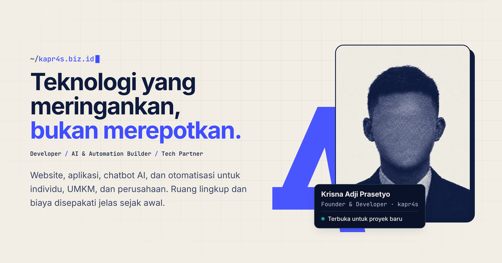

<div align="center">


# kapr4s.biz.id

**Portfolio and services site of Krisna Adji Prasetyo (kapr4s)**: websites, apps, AI chatbots & agents, and human-in-the-loop automation.

[](https://github.com/kapr4s/kapr4s.biz.id/actions/workflows/deploy.yml)


![HTML5][stack-html] ![CSS][stack-css] ![JavaScript][stack-js] ![Node.js][stack-node] ![Playwright][stack-playwright] ![GitHub Actions][stack-actions] ![GitHub Pages][stack-pages]

**[kapr4s.biz.id](https://kapr4s.biz.id)**



</div>

---

## Overview

A single-page, Indonesian-language marketing site, written in plain HTML, CSS and JavaScript modules, with no framework and no build step. Every page change is gated by unit, end-to-end and accessibility tests in CI before it is published to GitHub Pages.

| Aspect | Details |
|---|---|
| **Stack** | HTML5, modern CSS (custom properties, `clamp()`, grid), vanilla ES modules |
| **Runtime dependencies** | None. Fonts and icons are self-hosted |
| **Language** | Indonesian only (`lang="id"`) |
| **Contact flow** | Validated form → pre-filled WhatsApp message (`wa.me`), no backend, no data stored |
| **Quality gates** | `node:test` unit tests · Playwright E2E on desktop and mobile · axe-core WCAG 2.2 AA |
| **Hosting** | GitHub Pages via GitHub Actions, deployed from an explicit file allow-list |

## Features

- **Indonesian only**: all visible copy lives in `index.html`. Text written by JavaScript (form errors, the WhatsApp message template, the success note) lives in `assets/js/strings.js`.
- **Pricing tabs**: Personal, Bisnis and Enterprise packages sit behind a WAI-ARIA tablist with arrow-key, Home and End navigation. The active tab is mirrored in the URL hash (`#personal`, `#bisnis`, `#enterprise`), so each package can be linked directly.
- **Sections**: hero, technology marquee, about, problems, services, pricing, process, why kapr4s, FAQ and contact.
- **Motion**: staggered entrances, spring-like hover and press feedback, and a subtle portrait tilt, in plain CSS and one small module. All of it switches off under `prefers-reduced-motion`.
- **Progressive enhancement**: with JavaScript disabled the page is complete, every pricing panel is visible, links work and the form still submits to WhatsApp.
- **Accessibility**: skip link, landmark structure, visible focus on every surface, ARIA tabs, `aria-live` form errors, a pause control for moving content, reduced-motion support, and colour contrast ≥ 4.5:1.
- **Security**: strict Content-Security-Policy (`script-src 'self'`, no inline script or style), no `innerHTML`, user input only ever reaches the DOM through `textContent` or `encodeURIComponent`.
- **SEO and sharing**: canonical URL, Open Graph and Twitter cards, JSON-LD (`Person`, `ProfessionalService`, `FAQPage`, `WebSite`), `sitemap.xml`, `robots.txt`.
- **Performance**: ≈30 KB of compressed HTML, CSS and JS; WebP imagery with explicit dimensions; one preloaded font; animations limited to `transform` and `opacity`.

## Getting started

**Requirements:** Node.js 22+ (see [`.nvmrc`](.nvmrc)).

```bash
git clone https://github.com/kapr4s/kapr4s.biz.id.git
cd kapr4s.biz.id
npm ci
npx playwright install chromium   # first time only, for the E2E suite

npm run serve                     # http://127.0.0.1:4173
```

> Opening `index.html` directly from disk (`file://`) disables ES modules, so the pricing tabs and contact form will not run. Use `npm run serve`.

## Scripts

| Command | Description |
|---|---|
| `npm run serve` | Serve the site locally on port 4173 (zero-dependency Node server) |
| `npm test` | Run unit tests, then the Playwright + axe suite |
| `npm run test:unit` | Unit tests only (`node --test`) |
| `npm run test:e2e` | End-to-end and accessibility tests (desktop 1440 px and Pixel 7) |
| `npm run build` | Copy the publishable allow-list into `_site/` (what CI deploys) |

## Project structure

```text
.
├── index.html                 # Single page (Indonesian content, SEO metadata, JSON-LD)
├── 404.html                   # Branded not-found page
├── favicon.ico                # Browser tab icon
├── CNAME                      # Custom domain: kapr4s.biz.id
├── assets/
│   ├── css/
│   │   ├── tokens.css         # Design tokens: colour, type scale, spacing, motion
│   │   ├── base.css           # Reset, typography, buttons, utilities, print
│   │   ├── layout.css         # Header, navigation, hero, footer, floating button
│   │   ├── marquee.css        # Technology marquee with pause control
│   │   ├── sections.css       # Problems, process, why, FAQ and shared section styles
│   │   ├── services.css       # Services section
│   │   ├── pricing.css        # Pricing tabs and plan cards
│   │   ├── contact.css        # Contact section and form
│   │   ├── theme.css          # Colour roles, heading face, soft shadows, card radius
│   │   ├── motion.css         # Entrances, stagger and hover/press motion
│   │   └── 404.css            # Not-found page
│   ├── js/
│   │   ├── main.js            # DOM wiring: menu, reveal, marquee, form, floating button
│   │   ├── pricing-tabs.js    # WAI-ARIA tabs for pricing, synced with the URL hash
│   │   ├── lib.js             # Pure, unit-tested helpers (templating, WhatsApp URL, validation, tab keys and hashes)
│   │   ├── strings.js         # Indonesian strings used by JavaScript
│   │   ├── motion.js          # In-view stagger and portrait tilt (skipped for reduced motion)
│   │   └── config.js          # Contact details
│   ├── fonts/                 # Self-hosted variable WOFF2 + licence
│   └── img/                   # Logo, portrait, OG image, SVG icon sprites
├── tests/
│   ├── unit/                  # Helpers, strings, page content and contact-data consistency
│   ├── e2e/                   # Playwright specs (pricing, navigation, form, layout) incl. axe accessibility audit
│   └── serve.js               # Static server used locally and by Playwright
├── scripts/build-site.sh      # Deploy allow-list
├── docs/ARCHITECTURE.md       # Design decisions and trade-offs
└── .github/workflows/         # CI/CD pipeline
```

## Testing

| Suite | Scope |
|---|---|
| **Unit** (`tests/unit`) | Message templating, WhatsApp URL encoding (special characters, emoji, malformed UTF-16), form validation, tab keyboard and hash helpers; the WhatsApp and error strings match their contract; page content checks (required section ids, pricing names and prices, FAQ JSON-LD equal to the visible FAQ, Indonesian-only metadata, CSS files under 800 lines); a consistency check that every phone number, email and pricing CTA in the HTML matches `config.js` |
| **E2E** (`tests/e2e`) | Pricing tabs (ARIA wiring, default tab, hash sync without history entries, arrow, Home and End keys, roving tabindex, unknown hashes), mobile menu and focus management, contact form (errors, exact `wa.me` payload, special characters and emoji), floating button, marquee pause, no horizontal overflow from 320 to 1920 px, no console errors or failed requests, no-JS and reduced-motion behaviour |
| **Accessibility** | axe-core with WCAG 2.0, 2.1 and 2.2 A/AA rules, on `/` and each pricing tab (`/#personal`, `/#bisnis`, `/#enterprise`), on desktop and mobile |

## Deployment

[`.github/workflows/deploy.yml`](.github/workflows/deploy.yml) runs on every push and pull request:

1. **Test**: `npm ci`, install Chromium, `npm test`. A Playwright report is uploaded on failure.
2. **Build** (`main` only): `scripts/build-site.sh` copies an explicit allow-list into `_site/`. Tests, tooling and source files are never published.
3. **Deploy** (`main` only): `actions/deploy-pages` with minimal permissions (`pages: write`, `id-token: write`). Deploys are serialised and never cancelled mid-flight.

Pull requests run the test job only. Action and dev-dependency versions are pinned and updated deliberately.

## Editing content

| Change | Where |
|---|---|
| Page copy | `index.html` |
| Messages written by JavaScript (errors, WhatsApp template, success note) | `assets/js/strings.js` (checked by `tests/unit/strings.test.js`) |
| Pricing packages and prices | `index.html` pricing section, with matching `wa.me` links and JSON-LD (checked by `tests/unit/content.test.js`) |
| Colours, typography, spacing | `assets/css/tokens.css` |
| Phone number, email | `assets/js/config.js`, plus the `wa.me` / `mailto:` links and JSON-LD in `index.html` (enforced by tests) |
| Site URL / custom domain | `index.html` (canonical, Open Graph, JSON-LD), `sitemap.xml`, `robots.txt` |

Design decisions and known trade-offs are documented in [`docs/ARCHITECTURE.md`](docs/ARCHITECTURE.md).

## License

© 2026 Krisna Adji Prasetyo. All rights reserved. See [`LICENSE`](LICENSE). Bundled fonts are licensed under the SIL OFL 1.1 and technology logos are from Simple Icons (CC0).

<!-- Stack badges (shields.io flat style; reference links keep the header readable) -->
[stack-html]: https://img.shields.io/badge/HTML5-E34F26?logo=html5&logoColor=white
[stack-css]: https://img.shields.io/badge/CSS-663399?logo=css&logoColor=white
[stack-js]: https://img.shields.io/badge/JavaScript-F7DF1E?logo=javascript&logoColor=black
[stack-node]: https://img.shields.io/badge/Node.js-5FA04E?logo=nodedotjs&logoColor=white
[stack-playwright]: https://img.shields.io/badge/Playwright-2D4552?logo=data:image/svg%2Bxml;base64,PHN2ZyB4bWxucz0iaHR0cDovL3d3dy53My5vcmcvMjAwMC9zdmciIHZpZXdCb3g9IjIwIDE1IDc1IDcwIj48cGF0aCBmaWxsPSIjRTI1NzRDIiBkPSJNNDAgNjZWNjBMMjUgNjRDMjUgNjQgMjYgNTggMzQgNTVDMzcgNTUgMzkgNTUgNDAgNTVWMzJINDhDNDcgMjkgNDcgMjcgNDYgMjZDNDUgMjQgNDQgMjUgNDEgMjdDMzkgMjkgMzQgMzIgMjcgMzRDMjAgMzYgMTQgMzYgMTIgMzVDOCAzNSA3IDM0IDcgMzZDNyAzOSA4IDQyIDkgNDdDMTIgNTcgMjAgNzcgMzcgNzJDNDIgNzEgNDUgNjkgNDcgNjZINDBWNjZaTTE1IDQ3TDI3IDQ0QzI3IDQ0IDI3IDQ5IDIyIDUwQzE4IDUxIDE1IDQ3IDE1IDQ3WiIvPjxwYXRoIGZpbGw9IiMyRUFEMzMiIGQ9Ik04NSAzMkM4MiAzMyA3NSAzNCA2NiAzMUM1NiAyOSA1MCAyNCA0OCAyMkM0NCAxOSA0MyAxNyA0MSAyMEM0MCAyMyAzOCAyNyAzNyAzM0MzMyA0NyAzMSA3NCA1MiA4MEM3NCA4NiA4NiA2MSA4OSA0OEM5MSA0MSA5MiAzNyA5MiAzNEM5MiAzMSA5MCAzMiA4NSAzMlpNNDIgNDNDNDIgNDMgNDUgMzggNTEgNDBDNTcgNDEgNTcgNDggNTcgNDhMNDIgNDNaTTU2IDY3QzQ2IDY0IDQ0IDU2IDQ0IDU2TDcyIDY0QzcyIDY0IDY2IDcwIDU2IDY3Wk02NiA1MEM2NiA1MCA2OSA0NSA3NSA0N0M4MSA0OCA4MSA1NSA4MSA1NUw2NiA1MFoiLz48cGF0aCBmaWxsPSIjRDY1MzQ4IiBkPSJNMzUgNjJMMjUgNjRDMjUgNjQgMjYgNTggMzMgNTZMMjggMzRMMjcgMzRDMjAgMzYgMTQgMzYgMTIgMzVDOCAzNSA3IDM0IDcgMzZDNyAzOSA4IDQyIDkgNDdDMTIgNTcgMjAgNzcgMzcgNzJMMzggNzJMMzUgNjJaTTE1IDQ3TDI3IDQ0QzI3IDQ0IDI3IDQ5IDIyIDUwQzE4IDUxIDE1IDQ3IDE1IDQ3WiIvPjxwYXRoIGZpbGw9IiMxRDhEMjIiIGQ9Ik01NiA2N0w1NiA2N0M0NiA2NCA0NCA1NiA0NCA1Nkw1OCA2MEw2NiAzMUw2NiAzMUM1NiAyOSA1MCAyNCA0OCAyMkM0NCAxOSA0MyAxNyA0MSAyMEM0MCAyMyAzOCAyNyAzNyAzM0MzMyA0NyAzMSA3NCA1MiA4MEw1MyA4MEw1NiA2N1pNNDIgNDNDNDIgNDMgNDUgMzggNTEgNDBDNTcgNDEgNTcgNDggNTcgNDhMNDIgNDNaIi8+PC9zdmc+
[stack-actions]: https://img.shields.io/badge/GitHub%20Actions-2088FF?logo=githubactions&logoColor=white
[stack-pages]: https://img.shields.io/badge/GitHub%20Pages-222222?logo=github&logoColor=white
